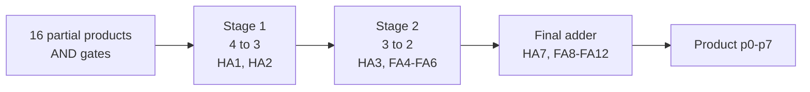
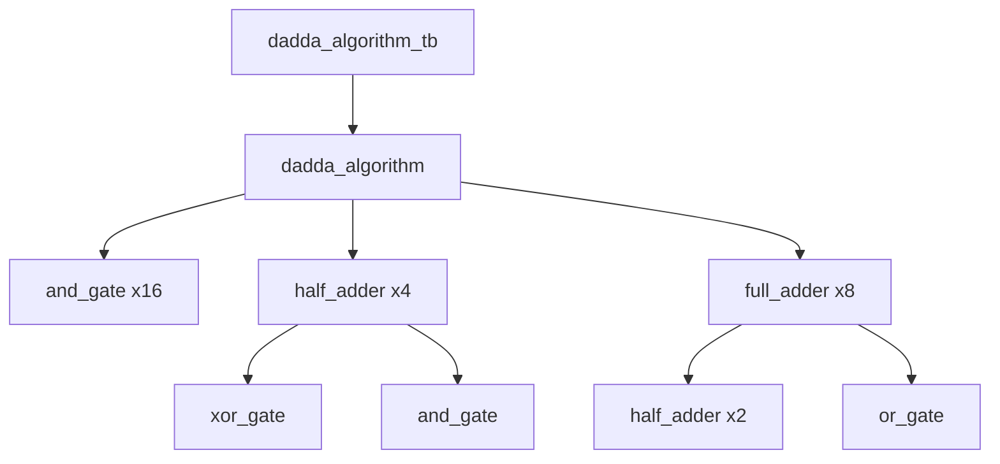

4-Bit Dadda Multiplier
-blue)


Full-custom, transistor-level design of a 4 × 4 unsigned Dadda multiplier in the gpdk090 (90 nm) process using Cadence Virtuoso, from basic gates to layout.
<p align="center">
  
</p>
---
Table of Contents
Overview
Dadda Algorithm
Design Hierarchy
Basic Gates
Half Adder and Full Adder
Symbols
Multiplier Design
Testbench
Simulation Results
Layout
Repository Structure
Getting Started
Future Work
Author
License
---
Overview
Parameter	Value
Multiplier	4 × 4 unsigned, Dadda tree
Inputs	`A0–A3`, `B0–B3`
Outputs	`p0–p7` (8-bit product)
Partial products	16 (AND gates)
Adders	4 Half Adders + 8 Full Adders
Instances in top schematic	28 (16 AND + 4 HA + 8 FA)
Technology	gpdk090 (90 nm)
Supply	1 V
Devices	`nmos1v`, `pmos1v` (W = 120 nm, L = 100 nm)
---
Dadda Algorithm
Every parallel multiplier works in three steps: generate partial products, reduce them to two rows, then add the two rows with a carry-propagate adder.
A Dadda multiplier reduces the partial-product matrix only as much as needed to reach the next target height. Compared with a Wallace tree it therefore uses fewer adders, at the cost of a wider final adder.
Target heights: `d(1) = 2`, `d(j+1) = floor(1.5 × d(j))` → `2, 3, 4, 6, 9, ...`
For 4 × 4, the tallest column has 4 bits, so the reduction is 4 → 3 → 2.

Partial products (`m0 … m15`):
	a3	a2	a1	a0
b0	m3	m2	m1	m0
b1	m7	m6	m5	m4
b2	m11	m10	m9	m8
b3	m15	m14	m13	m12
where `m(4j + i) = a_i · b_j`.
Column heights:
Weight	2⁰	2¹	2²	2³	2⁴	2⁵	2⁶
Bits	1	2	3	4	3	2	1
`P0 = m0` goes straight to the output without any adder.
---
Design Hierarchy

`and_gate`, `or_gate` and `xor_gate` each use an `inverter` internally.
---
Basic Gates
All gates are transistor-level (PMOS bulk to VDD, NMOS bulk to GND).
Inverter
<p align="center"></p>
When `a = 0` the PMOS pulls the output to VDD; when `a = 1` the NMOS pulls it to GND. Only one device conducts at a time, so static power is almost zero. The inverter also generates complemented inputs inside the other gates.
`a_bar = ¬a`
a	a_bar
0	1
1	0
AND Gate
<p align="center"></p>
Output is 1 only when both inputs are 1. Built from complementary PMOS/NMOS pairs (pass-transistor style) plus an inverter for `a_bar`. Used for every partial product and for the half-adder carry.
`ab = a · b`
a	b	ab
0	0	0
0	1	0
1	0	0
1	1	1
OR Gate
<p align="center"></p>
Output is 1 when at least one input is 1. Used in the full adder to combine the two half-adder carries.
`a+b = a + b`
a	b	a+b
0	0	0
0	1	1
1	0	1
1	1	1
XOR Gate
<p align="center"></p>
Output is 1 when the inputs differ. Inverters create `a_bar` and `b_bar`, and two PMOS/NMOS pairs select between them. XOR forms the sum logic of both adders.
`axorb = a ⊕ b = a·b' + a'·b`
a	b	axorb
0	0	0
0	1	1
1	0	1
1	1	0
---
Half Adder and Full Adder
Half Adder
<p align="center"></p>
One XOR gate (sum) and one AND gate (carry). Used in the Dadda tree where a column must shrink by exactly one bit.
```
sum   = a ⊕ b
carry = a · b
```
a	b	carry	sum
0	0	0	0
0	1	0	1
1	0	0	1
1	1	1	0
Full Adder
<p align="center"></p>
Two half adders and one OR gate. It compresses three bits of a column into one sum bit (same column) and one carry bit (next column), a 3:2 compressor.
```
sum   = a ⊕ b ⊕ c
carry = a·b + c·(a ⊕ b)
```
a	b	c	carry	sum
0	0	0	0	0
0	0	1	0	1
0	1	0	0	1
0	1	1	1	0
1	0	0	0	1
1	0	1	1	0
1	1	0	1	0
1	1	1	1	1
---
Symbols
<p align="center"></p>
Each verified schematic is wrapped into a symbol so it can be used as a black box in a higher-level schematic. This is bottom-up hierarchical design: each block is built and tested once, then reused.
---
Multiplier Design
Hand-Worked Algorithm
<p align="center"></p>
The 16 partial products are reduced stage by stage. Each block shows which bits enter which HA/FA and where the sum (`S`) and carry (`C`) go, until at most two bits remain per column.
Manual Wiring Plan
<p align="center"></p>
Block-level wiring derived from the algorithm: `m0–m15` enter at the top, HA1/HA2 form stage 1, HA3 and FA4–FA6 form stage 2, and HA7 with FA8–FA12 form the final adder. Sums stay in their column and carries move to the next column.
Top-Level Schematic
<p align="center"></p>
16 AND gates, 4 half adders and 8 full adders (28 instances, 16 pins). Critical path: AND gate → stage 1 → stage 2 → ripple through the final adder row.
---
Testbench
<p align="center"></p>
All eight inputs are driven by pulse sources, each with a different period (multiples of 10 ns), so many input combinations are applied in one run.
Parameter	Value
Source	Pulse voltage source
`v1` / `v2`	0 V / 1 V
Rise time	20 ps
Simulation time	0 – 160 ns
---
Simulation Results
Inputs
<p align="center"></p>
Square waves of 0 V → 1 V with different periods. At any instant the expected product is `A × B`, with `A = A3A2A1A0` and `B = B3B2B1B0`.
Outputs
<p align="center"></p>
Outputs switch between about 0 V and 1 V and change only after the inputs change (combinational logic).
Short glitches at transitions come from unequal path delays in the tree; they settle before the next input change.
Small level deviations (for example on `p1`) are due to the pass-transistor style gates.
`p0` has the shortest path; `p7` has the longest, through the final adder chain.
Expected Values for Checking
A	B	A × B	`p7 … p0`
0	0	0	`0000 0000`
1	1	1	`0000 0001`
3	5	15	`0000 1111`
7	9	63	`0011 1111`
10	12	120	`0111 1000`
15	15	225	`1110 0001`
---
Layout
<p align="center"></p>
Mask-level layout in gpdk090 (Nwell, Oxide, Poly, Pimp/Nimp, contacts, Metal1–Metal7). VDD rails run along the top and the blocks follow the column structure of the schematic.
[ ] DRC
[ ] LVS
[ ] PEX / post-layout simulation
---
Repository Structure
```
.
├── README.md
├── LICENSE
├── schematics/
│   ├── inverter.png
│   ├── and_gate.png
│   ├── or_gate.png
│   ├── xor_gate.png
│   ├── half_adder.png
│   ├── full_adder.png
│   ├── dadda_mult.png
│   └── dadda_mult_tb.png
├── symbols/
│   └── symbols.png
├── algorithm/
│   ├── algorithm.jpeg
│   └── manual_design.jpeg
├── outputs/
│   ├── transient_inputs.png
│   └── transient_outputs.png
└── layout/
    └── dadda_mult_lay.png
```
---
Getting Started
```bash
git clone https://github.com/<your-username>/<repo-name>.git
```
Open Cadence Virtuoso and open the library `project`.
Open the `dadda_algorithm_tb` schematic.
Launch ADE L, set up a transient analysis (stop time 160 ns) and select `p0–p7`.
Run the simulation and view results in Virtuoso Visualization & Analysis XL.
Open the `dadda_algorithm` layout and run DRC and LVS.
Requirements: Cadence Virtuoso 6.1.8, Spectre, gpdk090 PDK.
---
Future Work
Complete DRC, LVS and post-layout simulation
Measure delay, power and area
Compare with a Wallace tree multiplier
Extend to 8 × 8 and signed (Baugh–Wooley) multiplication
Replace pass-transistor gates with static CMOS to improve output levels
---
Author
P. Bharath Kumar
Department of Electronics and Communication Engineering
IIITDM Kurnool
---
License
This project is licensed under the MIT License. See LICENSE for details.
