4-Bit Dadda Multiplier (Cadence Virtuoso, gpdk090)
A full-custom design of a 4 × 4 unsigned Dadda multiplier built from transistor-level basic gates (inverter, AND, OR, XOR) in the gpdk090 (90 nm) process using Cadence Virtuoso. The design flows from gates → half adder → full adder → Dadda reduction tree → testbench → transient simulation → layout.
---
Table of Contents
Project Overview
Dadda Algorithm Theory
Design Hierarchy
Basic Gates
Half Adder and Full Adder
Symbols
Dadda Multiplier Schematic
Testbench
Simulation Results
Layout
Tools and Specifications
Folder Structure
How to Run
Author
---
1. Project Overview
Item	Value
Multiplier type	4 × 4 unsigned, Dadda tree
Inputs	`A0–A3`, `B0–B3` (8 inputs)
Outputs	`p0–p7` (8-bit product)
Partial products	16 (generated with AND gates)
Adders used	4 Half Adders + 8 Full Adders
Total instances in top schematic	28 (16 AND + 4 HA + 8 FA)
Technology	gpdk090 (90 nm)
Supply	VDD = 1 V
Transistor size	W = 120 nm, L = 100 nm (NMOS and PMOS)
---
2. Dadda Algorithm Theory
A multiplier has three steps: (1) generate partial products, (2) reduce them to two rows, (3) add the two rows with a final carry-propagate adder.
The Dadda multiplier differs from the Wallace multiplier in when it reduces. Wallace reduces as much as possible in each stage. Dadda reduces only as much as needed to reach the next target height, so it uses fewer adders in the reduction tree, at the cost of a slightly wider final adder.
Dadda height sequence: `d1 = 2, d2 = 3, d3 = 4, d4 = 6, d5 = 9, ...` where `d(j+1) = floor(1.5 × d(j))`.
For a 4 × 4 multiplier the tallest column has 4 bits, so the reduction runs: 4 → 3 → 2 (two reduction stages), followed by the final addition.
Building blocks
Half Adder (HA): 2 inputs → `sum = a ⊕ b`, `carry = a·b`. Reduces a column by 1 bit.
Full Adder (FA): 3 inputs → `sum = a ⊕ b ⊕ c`, `carry = ab + c(a ⊕ b)`. Reduces a column by 2 bits.
Partial product naming
`m0 … m15` are the partial products `a_i · b_j`:
	a3	a2	a1	a0
b0	m3 = a3b0	m2 = a2b0	m1 = a1b0	m0 = a0b0
b1	m7 = a3b1	m6 = a2b1	m5 = a1b1	m4 = a0b1
b2	m11 = a3b2	m10 = a2b2	m9 = a1b2	m8 = a0b2
b3	m15 = a3b3	m14 = a2b3	m13 = a1b3	m12 = a0b3
Column heights (weights 2⁰ … 2⁶)
Column	0	1	2	3	4	5	6
Bits	1	2	3	4	3	2	1
Reduction summary used in this design
Stage 1 (4 → 3): HA1 and HA2 reduce the tallest columns.
Stage 2 (3 → 2): HA3, FA4, FA5 and FA6 reduce the remaining columns to two rows.
Final addition: HA7 and FA8–FA12 form the carry-propagate adder producing `P1 … P7`. `P0 = m0` passes straight through.
---
3. Design Hierarchy
```
dadda_algorithm_tb
└── dadda_algorithm  (4-bit Dadda multiplier)
    ├── and_gate  ×16        (partial products)
    ├── half_adder ×4        (HA1, HA2, HA3, HA7)
    │   ├── xor_gate
    │   └── and_gate
    └── full_adder ×8        (FA4, FA5, FA6, FA8 – FA12)
        ├── half_adder ×2
        └── or_gate
            (xor_gate / and_gate / or_gate each use an inverter)
```
---
4. Basic Gates
All gates are built at transistor level with gpdk090 `nmos1v` / `pmos1v` devices (W = 120 nm, L = 100 nm, bulk of PMOS tied to VDD, bulk of NMOS tied to GND).
4.1 Inverter
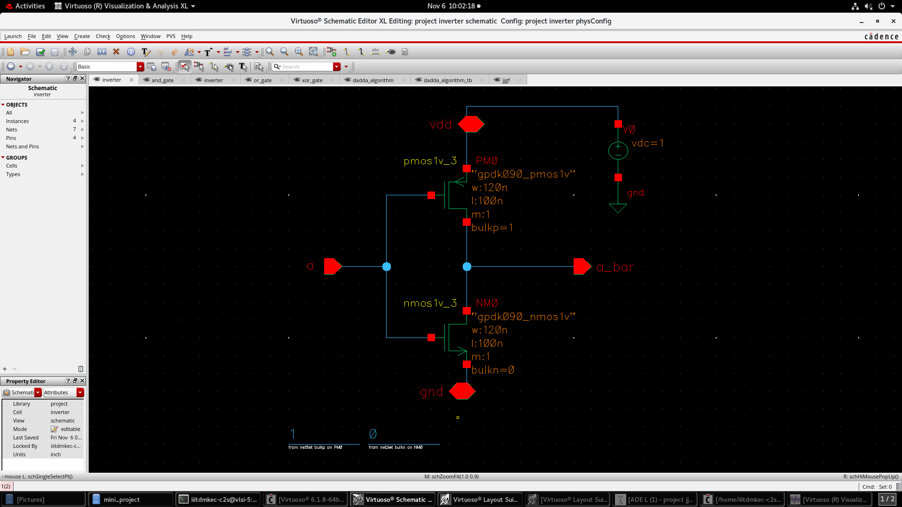
Theory: The CMOS inverter is the basic building block of digital logic. When `a = 0`, the PMOS conducts and pulls the output to VDD; when `a = 1`, the NMOS conducts and pulls the output to GND. So `a_bar = ¬a`. Only one transistor conducts at a time, so there is almost no static power; power is mainly dynamic (switching). The inverter is also used inside the other gates to generate the complement of an input.
a	a_bar
0	1
1	0
4.2 AND Gate
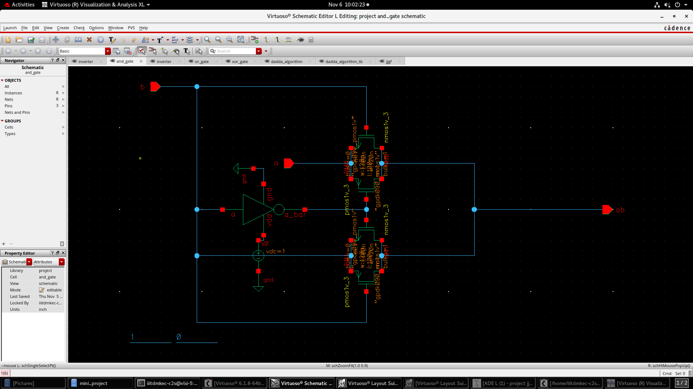
Theory: Implements `ab = a · b`. The output is 1 only when both inputs are 1. This design uses complementary PMOS/NMOS pairs (pass-transistor style) together with an inverter that generates `a_bar`. In the multiplier, the AND gate generates each partial product `a_i · b_j` and is also used for the carry of the half adder.
a	b	ab
0	0	0
0	1	0
1	0	0
1	1	1
4.3 OR Gate
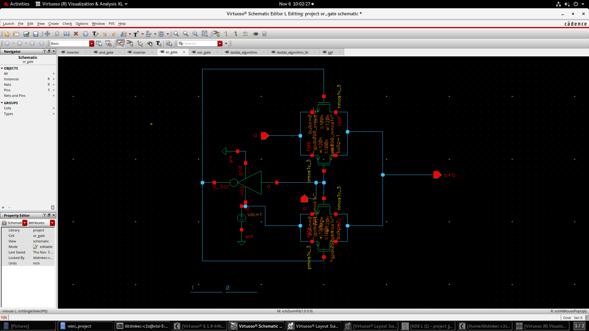
Theory: Implements `a + b`. The output is 1 if at least one input is 1. As in the AND gate, an inverter provides the complemented input to the PMOS/NMOS pairs. In the full adder, the OR gate combines the two half-adder carries into the final carry-out.
a	b	a+b
0	0	0
0	1	1
1	0	1
1	1	1
4.4 XOR Gate
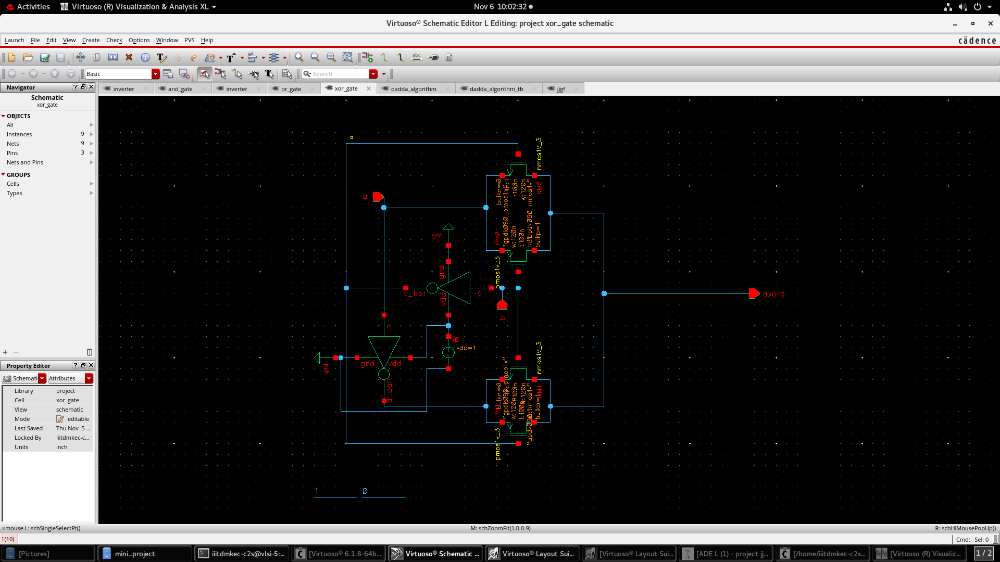
Theory: Implements `a ⊕ b = a·b' + a'·b`. The output is 1 when the inputs differ. It uses inverters to produce `a_bar` and `b_bar` and two PMOS/NMOS pairs to select between `b` and `b_bar` depending on `a`. XOR is the core of the sum logic in both the half adder and the full adder.
a	b	a ⊕ b
0	0	0
0	1	1
1	0	1
1	1	0
---
5. Half Adder and Full Adder
5.1 Half Adder
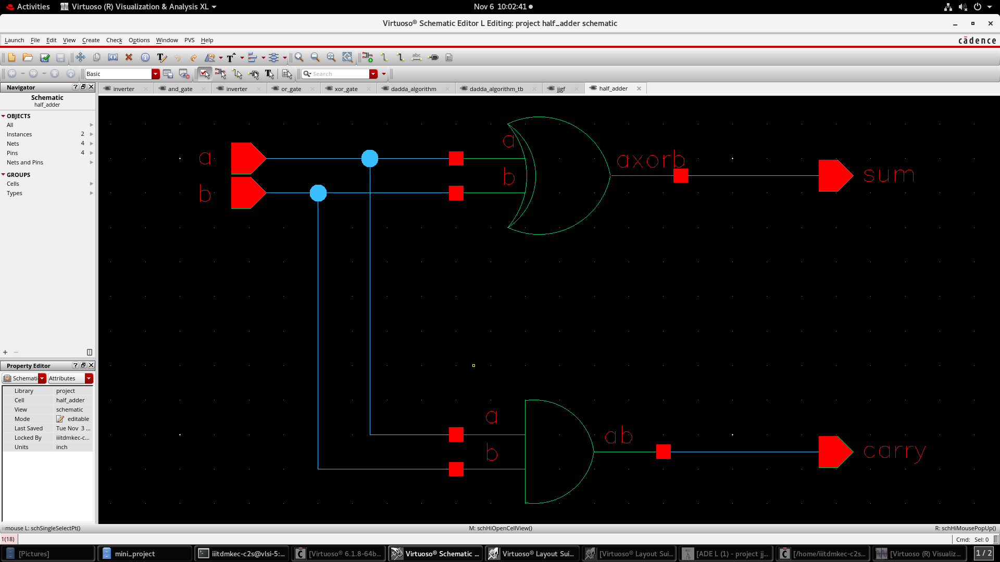
Theory: Adds two single-bit numbers.
`sum = a ⊕ b`
`carry = a · b`
It is built from one XOR gate and one AND gate. In a Dadda tree, a half adder is used sparingly, only where a column must be reduced by exactly one bit.
a	b	carry	sum
0	0	0	0
0	1	0	1
1	0	0	1
1	1	1	0
5.2 Full Adder
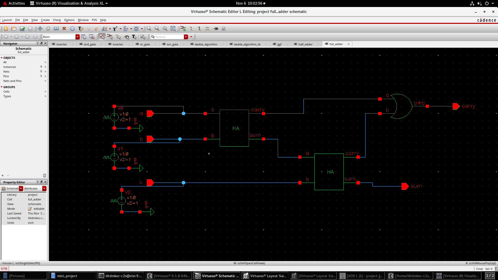
Theory: Adds three single-bit inputs (`a`, `b`, `c`, where `c` is the carry-in).
`sum = a ⊕ b ⊕ c`
`carry = a·b + c·(a ⊕ b)`
It is built from two half adders and one OR gate: HA1 adds `a` and `b`; HA2 adds HA1's sum with `c`; the OR gate combines both carries. A full adder compresses three bits of one column into one sum bit (same column) and one carry bit (next column), a 3:2 compressor.
a	b	c	carry	sum
0	0	0	0	0
0	0	1	0	1
0	1	0	0	1
0	1	1	1	0
1	0	0	0	1
1	0	1	1	0
1	1	0	1	0
1	1	1	1	1
---
6. Symbols
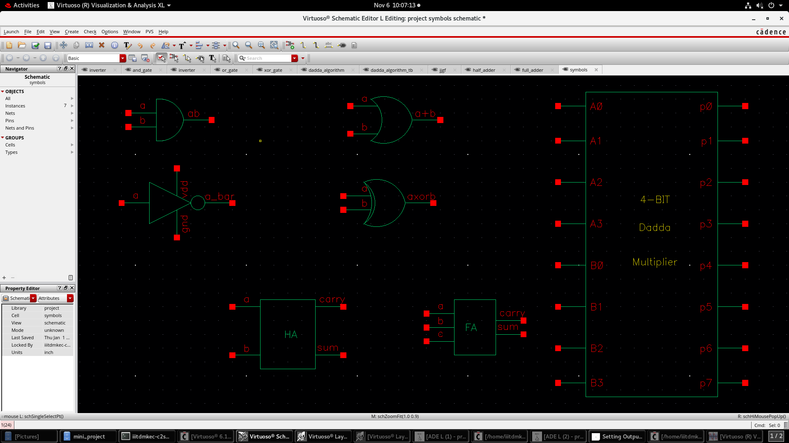
Theory: In hierarchical design, every verified schematic is wrapped into a symbol so it can be instantiated as a black box in a higher-level schematic. This keeps the top-level schematic readable and lets each block be designed and tested independently (bottom-up design). Symbols were created for the AND, OR, XOR, inverter, half adder, full adder and the complete 4-bit Dadda multiplier (inputs `A0–A3`, `B0–B3`; outputs `p0–p7`).
---
7. Dadda Multiplier Schematic
7.1 Algorithm (hand-worked)
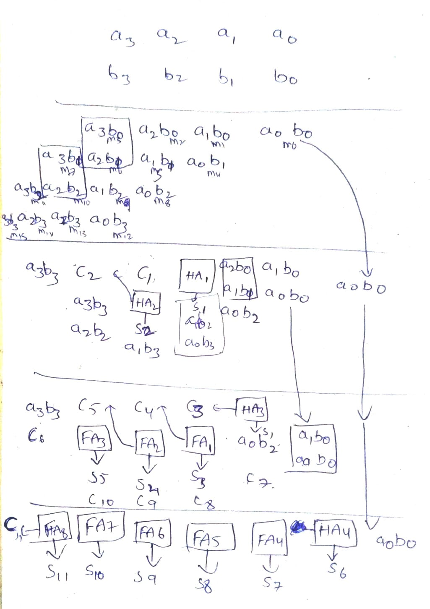
Theory: This sheet shows the reduction applied to the partial-product matrix. Row 1 holds the operands, the next block holds the 16 partial products (`m0–m15`), and each following block is one reduction stage showing which bits go into which HA/FA and where the sum (`S`) and carry (`C`) land. The process continues until at most two bits remain per column, and the final stage adds them to get `S6 … S11`, which map to the upper product bits. `a0b0` is already a single bit and is carried down directly as `P0`.
7.2 Manual Design (wiring plan)
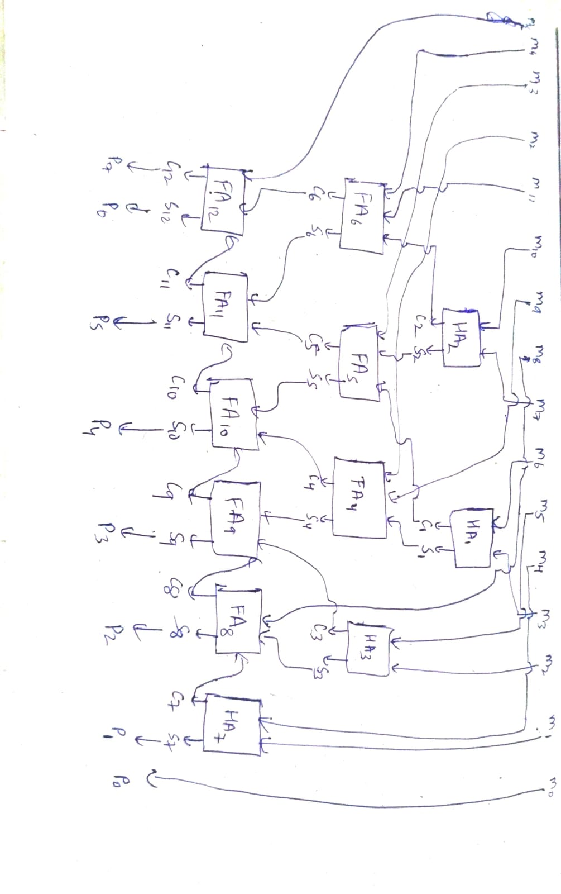
Theory: This is the block-level wiring plan derived from the algorithm. Partial products `m0 … m15` enter at the top; HA1/HA2 form stage 1; FA4–FA6 and HA3 form stage 2; HA7 and FA8–FA12 form the final carry-propagate stage. Each adder's sum stays in its column and its carry goes to the next higher column. The outputs at the bottom are `P0 … P7`. This plan was used to place and wire the schematic.
7.3 Transistor-level Schematic
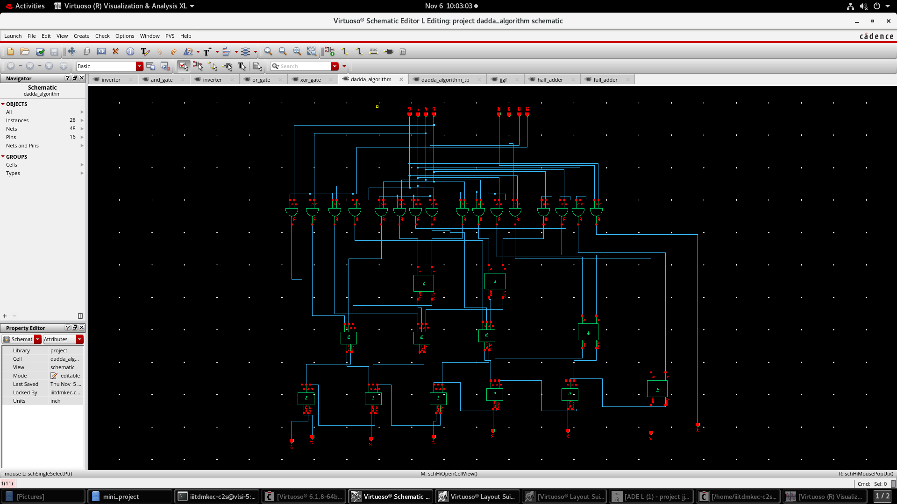
Theory: The top-level schematic contains 16 AND gates (partial-product generation), 4 half adders and 8 full adders (28 instances, 16 pins: `A0–A3`, `B0–B3`, `p0–p7`). Compared with a Wallace tree, the Dadda tree needs fewer reduction-stage adders; the trade-off is a longer final adder. Critical path: AND gate → stage 1 → stage 2 → ripple through the final adder row.
---
8. Testbench
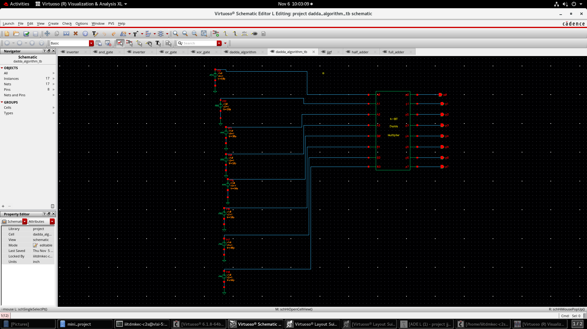
Theory: The testbench instantiates the multiplier symbol and drives all eight inputs (`A0–A3`, `B0–B3`) with pulse voltage sources (`v1 = 0 V`, `v2 = 1 V`, rise time `tr = 20 ps`). Each source has a different period (multiples of 10 ns), so the inputs step through different logic combinations over time, which is a practical way to exercise many input patterns in a single transient run. Outputs `p0–p7` are probed as output pins.
---
9. Simulation Results
9.1 Input Waveforms
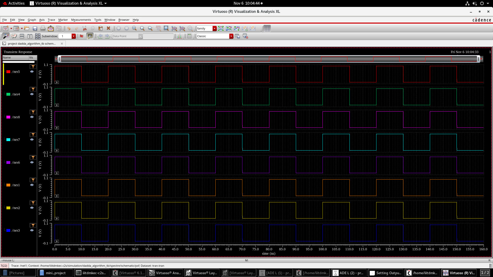
Theory: These are the input stimuli over 0–160 ns. Each trace is a square wave of 0 V → 1 V with a different period, so the input operands change at different rates. The product at any moment equals `A × B` where `A = A3A2A1A0` and `B = B3B2B1B0` read at that time instant.
9.2 Output Waveforms
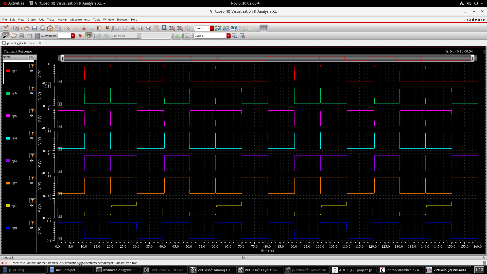
Theory: Outputs `p0 … p7` form the 8-bit product. Observations:
Outputs swing between ~0 V (logic 0) and ~1 V (logic 1) and change only after the inputs change, as expected for combinational logic.
Short glitches (spikes) appear at transitions because signals arrive at the adders at different times (unequal path delays through the tree). These settle before the next input change, so the steady-state values are correct. Glitches are normal in combinational multipliers.
Small deviations in logic levels (e.g. on `p1`) come from pass-transistor style gates, which can slightly degrade the output level.
`p0 = a0·b0` has the shortest path, while `p7` (the most significant bit) has the longest delay through the final adder chain.
> To verify: pick any time instant, read `A` and `B` from the input plot, multiply them, and compare with the 8-bit value read from `p7…p0`.
---
10. Layout
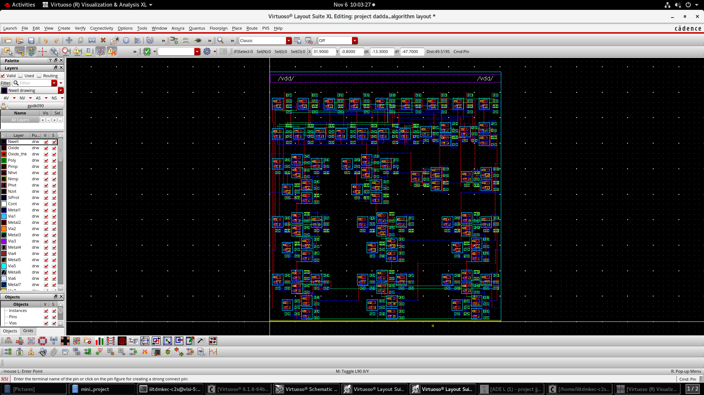
Theory: The layout is the physical, mask-level representation of the circuit in gpdk090 (Nwell, Oxide, Poly, Pimp/Nimp, Contacts, Metal1–Metal7 and vias). The layout is organised with the VDD rails at the top and each gate/adder placed as a block, following the same column-wise structure as the schematic. Routing between blocks uses the metal layers.
Layout verification steps:
[ ] DRC (Design Rule Check)
[ ] LVS (Layout vs Schematic)
[ ] PEX / post-layout simulation
(Tick off the steps you have completed.)
---
11. Tools and Specifications
Item	Details
EDA tool	Cadence Virtuoso 6.1.8 (Schematic Editor, Layout Suite XL)
Simulator	Spectre (via ADE L)
Waveform viewer	Virtuoso Visualization & Analysis XL
PDK	gpdk090
Analysis	Transient, 0–160 ns
Supply	1 V DC
Devices	`nmos1v`, `pmos1v` (W = 120 nm, L = 100 nm)
---
12. Folder Structure
```
.
├── README.md
└── images/
    ├── inverter.png
    ├── and_gate.png
    ├── or_gate.png
    ├── xor_gate.png
    ├── half_adder.png
    ├── full_adder.png
    ├── symbols.png
    ├── algorithm.jpeg
    ├── manual_design.jpeg
    ├── dadda_mult.png
    ├── dadda_mult_tb.png
    ├── transient_inputs.png
    ├── transient_outputs.png
    └── dadda_mult_lay.png
```
---
13. How to Run
Open Virtuoso and open the library `project`.
Open the `dadda_algorithm_tb` schematic.
Launch ADE L and set up a transient analysis (stop time 160 ns).
Select the output nets `p0–p7` and run the simulation.
View the waveforms in the Visualization & Analysis tool.
Open `dadda_algorithm` layout for physical design and run DRC/LVS.
---
14. Author
Name: P.Bharath Kumar, Dept Of ECE
Institute: IIITDM Kurnool
